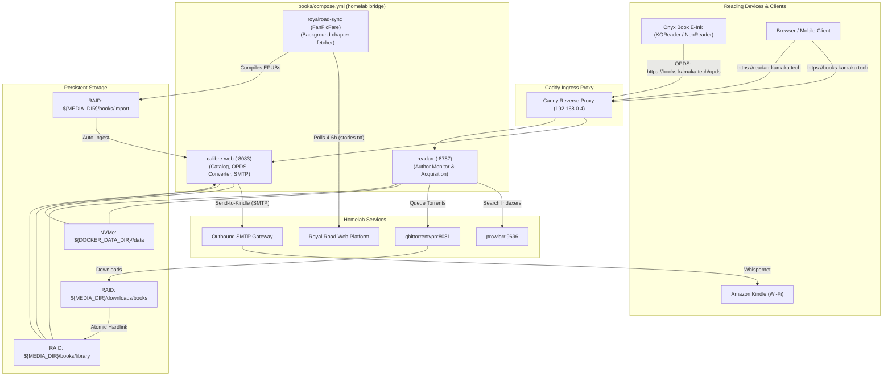

# Implementation Plan: E-Book & Web Serial Automation Stack (`books/compose.yml`)

## 1. Overview & Architecture

This feature implements a dedicated, modular Dockge Compose stack (`books/compose.yml`) for managing e-books, commercial book acquisition, wireless reading device distribution (Amazon Kindle and Onyx Boox), and automated background chapter tracking for Royal Road web serials.

### System Architecture Diagram


---

## 2. Component Specifications

### 2.1 Core Services in `books/compose.yml`
1. **`calibre-web` (`lscr.io/linuxserver/calibre-web:latest`)**:
   - Internal Port: `8083`
   - Role: Library browser, reader, OPDS catalog, metadata editor, Calibre format converter (`ebook-convert`), and Send-to-Kindle SMTP dispatcher.
   - Volumes:
     - `${DOCKER_DATA_DIR}/calibre-web/data:/config` (NVMe: app settings, user database `app.db`)
     - `${MEDIA_DIR}/books/library:/books` (RAID: canonical Calibre library with `metadata.db`)
     - `${MEDIA_DIR}/books/import:/import` (RAID: drop directory for automatic book ingestion)
   - Caddy Labels:
     - `caddy=books.kamaka.tech`
     - `caddy.reverse_proxy={{upstreams 8083}}`
     - `caddy.import=cloudflare_tls lan_only`
   - Homepage Labels:
     - `homepage.group=Media`
     - `homepage.name=Books (Calibre)`
     - `homepage.icon=calibre-web`
     - `homepage.href=https://books.kamaka.tech`

2. **`readarr` (`lscr.io/linuxserver/readarr:develop`)**:
   - Internal Port: `8787`
   - Role: Commercial book acquisition pipeline. Interfaces with Prowlarr indexers and qBittorrent download client.
   - Volumes:
     - `${DOCKER_DATA_DIR}/readarr/data:/config` (NVMe: database, logs, indexer states)
     - `${MEDIA_DIR}/books/library:/books` (RAID: media library destination)
     - `${MEDIA_DIR}:/media` (RAID: allows zero-copy atomic hardlinks between `/media/downloads/books` and `/media/books/library`)
   - Caddy Labels:
     - `caddy=readarr.kamaka.tech`
     - `caddy.reverse_proxy={{upstreams 8787}}`
     - `caddy.import=cloudflare_tls lan_only`
   - Homepage Labels:
     - `homepage.group=Media Automation`
     - `homepage.name=Readarr`
     - `homepage.icon=readarr`
     - `homepage.href=https://readarr.kamaka.tech`

3. **`royalroad-sync` (FanFicFare worker container)**:
   - Lightweight Python container running FanFicFare CLI on a continuous 4–6 hour loop.
   - Reads declarative URL list from `/config/stories.txt`.
   - Executes incremental updates: `fanficfare -u -i /config/stories.txt --config /config/personal.ini`.
   - Outputs newly generated or updated `.epub` files directly into `/import` (`${MEDIA_DIR}/books/import`).
   - Volumes:
     - `${DOCKER_DATA_DIR}/royalroad/data:/config` (NVMe: `stories.txt`, `personal.ini`, history cache)
     - `${MEDIA_DIR}/books/import:/import` (RAID: Calibre-Web auto-ingestion drop directory)

---

## 3. Storage Tiering & Filesystem Layout

| Path on Host | Storage Pool | Purpose | Permissions |
| :--- | :--- | :--- | :--- |
| `/volume2/docker/calibre-web/data` | NVMe SSD | Calibre-Web configuration and user SQLite database | `1000:100` |
| `/volume2/docker/readarr/data` | NVMe SSD | Readarr SQLite database (`readarr.db`) and caches | `1000:100` |
| `/volume2/docker/royalroad/data` | NVMe SSD | FanFicFare story URL manifest and update state | `1000:100` |
| `/volume1/media/books/library` | Mechanical RAID 5 | Canonical book library directory and `metadata.db` | `1000:100` |
| `/volume1/media/books/import` | Mechanical RAID 5 | Auto-ingestion staging folder watched by Calibre-Web | `1000:100` |
| `/volume1/media/downloads/books` | Mechanical RAID 5 | Staging folder for completed qBittorrent downloads | `1000:100` |

---

## 4. Environment Variables & Templates

### 4.1 Root `.env.example`
Add:
- `READARR_API_KEY=` (optional placeholder for test suites)
- `SMTP_HOST=`, `SMTP_PORT=`, `SMTP_USER=`, `SMTP_PASS=`, `SMTP_FROM=` (optional Send-to-Kindle outbound relay)

### 4.2 Stack `books/.env.example`
```env
# Calibre-Web & Readarr Configuration
READARR_API_KEY=
CALIBRE_USER=admin
CALIBRE_PASSWORD=

# Send-to-Kindle SMTP Relay (Optional for Kindle wireless delivery)
SMTP_HOST=
SMTP_PORT=587
SMTP_USER=
SMTP_PASS=
SMTP_FROM=
KINDLE_MAIL=
```

---

## 5. Phased Implementation Steps

### Phase 1: Environment & Directory Scaffolding
1. Create `books/` directory.
2. Author `books/.env.example`.
3. Create host storage directories:
   - `${DOCKER_DATA_DIR}/calibre-web/data`
   - `${DOCKER_DATA_DIR}/readarr/data`
   - `${DOCKER_DATA_DIR}/royalroad/data`
   - `${MEDIA_DIR}/books/library`
   - `${MEDIA_DIR}/books/import`
   - `${MEDIA_DIR}/downloads/books`
4. Initialize blank Calibre `metadata.db` in `${MEDIA_DIR}/books/library` (required for Calibre-Web initial startup).

### Phase 2: FanFicFare Worker Definition
1. Author lightweight Dockerfile in `books/fanficfare/Dockerfile` (or root `books/`):
   - Alpine base with Python 3 and FanFicFare package (`pip install fanficfare`).
   - Shell loop entrypoint checking `/config/stories.txt` every 4 hours, executing update in `/import`.
2. Seed initial `/config/stories.txt` template and `personal.ini`.

### Phase 3: Compose Specification (`books/compose.yml`)
1. Author `books/compose.yml` adhering strictly to canonical key order, variable assertions (`:?`), non-root execution (`1000:100`), logging limits (`10m`/3), Caddy labels, and Homepage labels.

### Phase 4: Network & Reverse Proxy Convergence
1. Run `./homelab.sh setup` to provision stack `.env`, synchronize variables, and launch containers.
2. Verify Caddy auto-discovery dynamically routes `https://books.kamaka.tech` and `https://readarr.kamaka.tech`.

### Phase 5: Automated Test Coverage (`.tests/suites/`)
1. Add container health checks for `calibre-web`, `readarr`, and `royalroad-sync` in `test_containers.sh`.
2. Add reverse proxy routing assertions for `books.kamaka.tech` and `readarr.kamaka.tech` in `test_routing.sh`.
3. Add interconnect assertion testing Readarr API health and OPDS catalog endpoint availability (`https://books.kamaka.tech/opds`) in `test_interconnect.sh`.

### Phase 6: Documentation Audit & User Review Checkpoint
1. Run `./homelab.sh test all` to verify complete test suite pass.
2. Update `README.md` and `.docs/service-catalog.md` with new `books` services and ports.
3. Pause and present working state, test results, and runtime logs to the user for explicit review before proceeding to feature completion.
