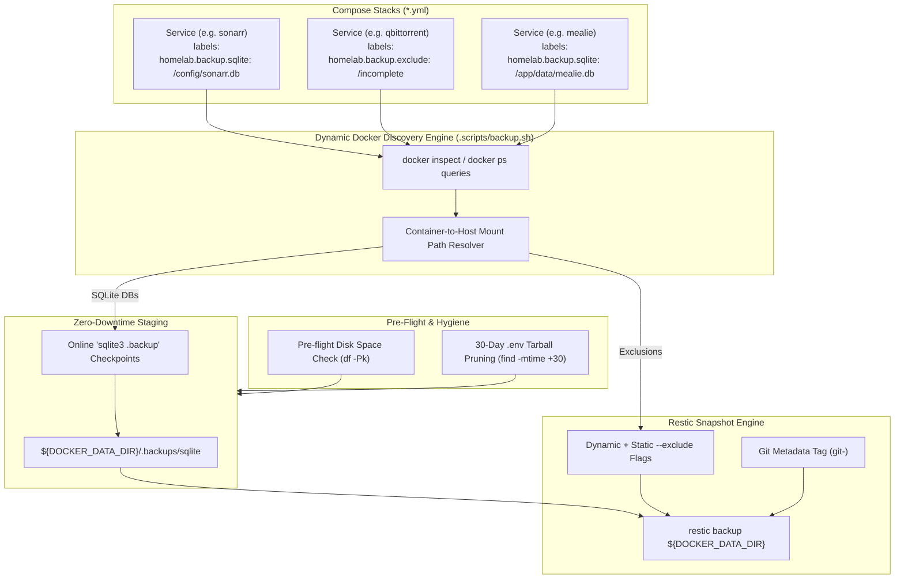

# Implementation Plan: Declarative Backups & Backup Engine Modernization

## 1. Overview & Architecture

This feature modernizes the homelab disaster recovery, snapshot automation, and versioning architecture across four main pillars:
1. **Separation of Concerns**: Moves version calculation (`bump_semver`), chronological tag generation (`resolve_chronological_tag`), and tag argument resolution from `.scripts/backup.sh` into `.scripts/common.sh`.
2. **Declarative Backup Metadata**: Replaces the hardcoded imperative database list and static exclusions in `.scripts/backup.sh` with a dynamic Docker label-driven discovery model using the `homelab.backup.*` namespace.
3. **Operational Safety & Git Decoupling**: Eliminates unintended auto-commits and pushes of dirty working tree states during scheduled volume backups. Captures the active git commit SHA as snapshot metadata (`git-<sha>`) instead.
4. **Disaster Recovery Hygiene & Integrity**: Enforces pre-flight disk capacity checks, prunes stale `.env` secret archives on NVMe, exposes `homelab.sh backup check` for Restic index verification, and purges obsolete PostgreSQL/NPM legacy code.

### Architecture Diagram

---

## 2. Specification: `homelab.backup.*` Label Namespace

| Label | Scope | Value Format | Description & Behavior |
| :--- | :--- | :--- | :--- |
| **`homelab.backup.sqlite`** | Container | Comma-delimited paths | Container-internal paths to SQLite database files. The backup orchestrator resolves mounts to the host filesystem and performs an online `.backup` to the staging directory prior to taking the Restic volume snapshot. |
| **`homelab.backup.exclude`** | Container | Comma-delimited paths | Container-internal paths (or volume subdirectories) to exclude from the Restic snapshot (e.g., scratch directories like `/incomplete`). The orchestrator resolves these to host paths and appends `--exclude` flags. |
| **`homelab.backup.enable`** | Container | Boolean (`true` / `false`) | Optional explicit toggle (defaults to `true`). Allows declaring that a service should be completely ignored by the backup staging engine. |

---

## 3. Detailed Implementation Steps

### Step 1: Consolidate Versioning into `.scripts/common.sh`
* Extract from `.scripts/backup.sh` into `.scripts/common.sh`:
  * `bump_semver`: Semantic version bumping (major, minor, patch).
  * `resolve_chronological_tag`: CalVer sequence tag calculation (`YYYY.M.D[.seq]`).
  * `resolve_release_tags`: Tag argument parsing (supporting SemVer, CalVer, custom strings).
* Ensure backward-compatible alias `resolve_backup_tags` is maintained in `common.sh`.
* Remove duplicate functions from `.scripts/backup.sh`.

### Step 2: Decorate Compose Stacks with `homelab.backup.*` Labels
Update all active stack `compose.yml` files with explicit declarations:
* **`media/compose.yml`**:
  * `sonarr`: `homelab.backup.sqlite=/config/sonarr.db`
  * `radarr`: `homelab.backup.sqlite=/config/radarr.db`
  * `prowlarr`: `homelab.backup.sqlite=/config/prowlarr.db`
  * `jellyfin`: `homelab.backup.sqlite=/config/data/jellyfin.db`
* **`productivity/compose.yml`**:
  * `mealie`: `homelab.backup.sqlite=/app/data/mealie.db`
* **`books/compose.yml`**:
  * `bindery`: `homelab.backup.sqlite=/config/bindery.db`
  * `calibre-web`: `homelab.backup.sqlite=/config/app.db, /books/metadata.db`
* **`torrent/compose.yml`**:
  * `cleanuparr`: `homelab.backup.sqlite=/config/cleanuparr.db`
  * `qbittorrent`: `homelab.backup.exclude=/incomplete`

### Step 3: Refactor `.scripts/backup.sh`
1. **Dynamic SQLite Staging Discovery**:
   * Inspect running containers declaring `homelab.backup.sqlite`.
   * Parse internal paths, resolve them to host volume source directories via `.Mounts`.
   * Execute atomic `sqlite3 .backup` checkpoints into `${DOCKER_DATA_DIR}/.backups/sqlite/`.
2. **Dynamic Exclusion Resolution**:
   * Inspect running containers declaring `homelab.backup.exclude`.
   * Resolve container paths to host volume source directories.
   * Generate dynamic `--exclude` flags for `restic backup`.
3. **Decouple Git Commits**:
   * Stop running `git add -A` and `git commit` inside `backup_homelab()` by default.
   * Only commit if explicit `--commit` flag or commit message is passed.
   * By default, tag the Restic snapshot with the active commit SHA (`--tag "git-$(git rev-parse --short HEAD)"`).
4. **Disk Space Pre-Flight Check**:
   * Ensure at least 5 GB available on `${DOCKER_DATA_DIR}` and 10 GB on `${BACKUP_RESTIC_REPO}` before starting.
5. **Local Secret Archive Pruning**:
   * Add 30-day retention cleanup for local `${DOCKER_DATA_DIR}/backup/homelab/*_env_secrets.tar.gz`.
6. **Repository Verification**:
   * Add `check_restic_repo()` function exposing `homelab.sh backup check` (`restic check`).
7. **Purge Decommissioned Code**:
   * Remove PostgreSQL dump logic and `chown 70:70` restore logic.
   * Remove references to Nginx Proxy Manager in script documentation.

### Step 4: Automated Testing & Verification
* Update `.tests/suites/test_backup.sh`:
  * Add test verifying `homelab.backup.sqlite` discovery and mount path resolution.
  * Add test verifying `homelab.backup.exclude` discovery.
  * Verify SemVer bumping, tag resolution, and retention checks pass cleanly from `common.sh`.
* Run `./homelab.sh test all` to verify zero regressions across all suites.
