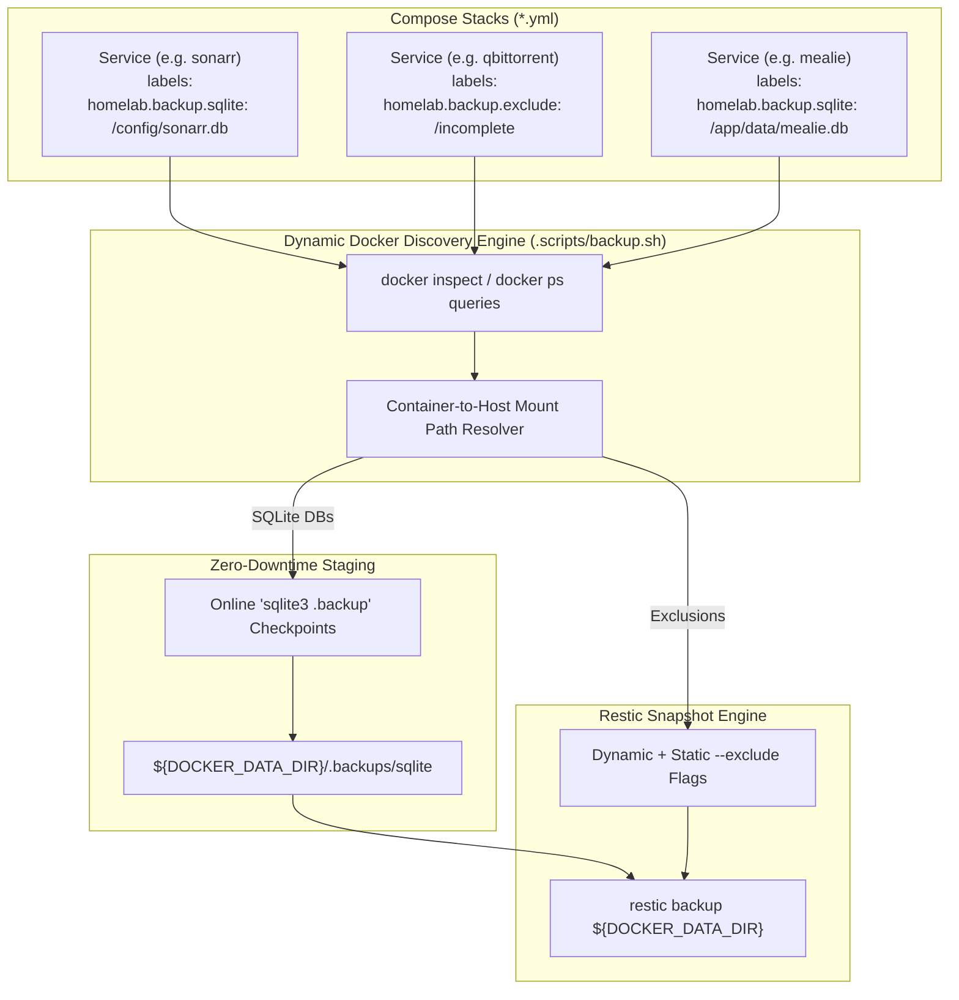

# Implementation Plan: Declarative Backups & Versioning Consolidation

## 1. Overview & Architecture

This feature refactors the homelab disaster recovery and versioning architecture across two major axes:
1. **Separation of Concerns**: Moves version calculation (`bump_semver`), chronological tag generation (`resolve_chronological_tag`), and tag argument resolution from `.scripts/backup.sh` into `.scripts/common.sh`.
2. **Declarative Backup Metadata**: Replaces the hardcoded imperative database list and static exclusions in `.scripts/backup.sh` with a dynamic Docker label-driven discovery model using the `homelab.backup.*` namespace.

### Architecture Diagram

---

## 2. Specification: `homelab.backup.*` Label Namespace

| Label | Scope | Value Format | Description & Behavior |
| :--- | :--- | :--- | :--- |
| **`homelab.backup.sqlite`** | Container | Comma-delimited paths | Container-internal paths to SQLite database files. The backup orchestrator resolves the mount to the host filesystem and performs an online `.backup` to the staging directory prior to taking the Restic volume snapshot. |
| **`homelab.backup.exclude`** | Container | Comma-delimited paths | Container-internal paths (or volume subdirectories) to exclude from the Restic snapshot (e.g., scratch directories like `/incomplete`). The orchestrator resolves these to host paths and appends `--exclude` flags. |
| **`homelab.backup.enable`** | Container | Boolean (`true` / `false`) | Optional explicit toggle (defaults to `true`). Allows declaring that a service should be completely ignored by the backup staging engine. |

---

## 3. Touchpoints & Implementation Steps

### Step 1: Consolidate Versioning into `.scripts/common.sh`
* Move the following functions from `.scripts/backup.sh` to `.scripts/common.sh`:
  * `bump_semver`: Semantic version bumping (major, minor, patch).
  * `resolve_chronological_tag`: CalVer sequence tag calculation (`YYYY.M.D[.seq]`).
  * `resolve_backup_tags` (renamed to `resolve_release_tags` with backward-compatible alias).
* Remove redundant implementations from `.scripts/backup.sh`.
* Verify that `.tests/suites/test_backup.sh` and `homelab.sh` seamlessly call the consolidated functions.

### Step 2: Decorate Compose Stacks with `homelab.backup.*` Labels
Update all active stack `compose.yml` files with explicit declarations:
* **`media/compose.yml`**:
  * `sonarr`: `homelab.backup.sqlite=/config/sonarr.db`
  * `radarr`: `homelab.backup.sqlite=/config/radarr.db`
  * `prowlarr`: `homelab.backup.sqlite=/config/prowlarr.db`
  * `jellyfin`: `homelab.backup.sqlite=/config/data/jellyfin.db`
* **`productivity/compose.yml`**:
  * `mealie`: `homelab.backup.sqlite=/app/data/mealie.db`
* **`books/compose.yml`**:
  * `bindery`: `homelab.backup.sqlite=/config/bindery.db`
  * `calibre-web`: `homelab.backup.sqlite=/config/app.db, /books/metadata.db`
* **`torrent/compose.yml`**:
  * `cleanuparr`: `homelab.backup.sqlite=/config/cleanuparr.db`
  * `qbittorrentvpn`: `homelab.backup.exclude=/incomplete`

### Step 3: Refactor `.scripts/backup.sh` Discovery Engine
* Replace the static `sqlite_dbs` array in `stage_database_dumps()` with dynamic Docker inspection:
  1. Discover all containers declaring `homelab.backup.sqlite`.
  2. Parse the container-internal path(s).
  3. Map the internal container path to the host filesystem path via the container's `.Mounts` bindings.
  4. Perform atomic online `sqlite3 .backup` checkpoints into `${staging_dir}/sqlite/`.
* Implement dynamic exclusion resolution:
  1. Discover containers declaring `homelab.backup.exclude`.
  2. Map container-internal exclude paths to host paths.
  3. Append dynamic `--exclude` parameters to the existing static pattern exclusions.
* Remove obsolete PostgreSQL online dump logic (decommissioned in release 3.0.0).

### Step 4: Automated Testing & Verification
* Update `.tests/suites/test_backup.sh`:
  * Add unit/integration assertions verifying `homelab.backup.sqlite` discovery and host mount path translation.
  * Add assertions verifying `homelab.backup.exclude` discovery.
  * Verify SemVer bumping and tag resolution continue passing when executed from `common.sh`.
* Run `./homelab.sh test all` to ensure zero regressions across all 65+ tests.
