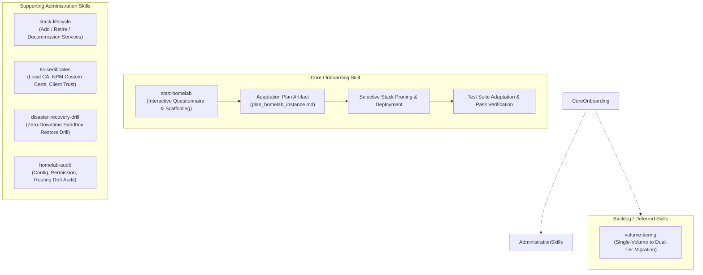

# Architectural Plan: Homelab Developer Administration & Onboarding Skills Suite

## 1. Problem Statement & Scope

As the homelab repository has matured with comprehensive automation (`homelab.sh`), multi-service compose stacks, dual-tier storage topologies, and strict test coverage, onboarding a new developer or provisioning a new homelab instance from this repository requires navigating numerous interconnected decisions:
1. Selecting which services to run immediately vs defer vs prune.
2. Mapping host storage volumes (single mechanical array vs dual-tier NVMe/RAID).
3. Provisioning external accounts, secrets, and environment files (`.env`).
4. Running idempotency setup (`homelab.sh setup`) and adapting test suites to match the pruned service footprint.

This feature introduces a modular suite of agent skills under `.agents/skills/` (mirrored at `.skills/`) designed to guide homelab developers through instance onboarding, ongoing lifecycle maintenance, and disaster recovery verification.

---

## 2. Proposed Skills Architecture

### Skill 1: `start-homelab` (Primary Onboarding Skill)
- **Purpose**: Interactive, step-by-step onboarding wizard for developers instantiating a fresh homelab from this template repository.
- **Workflow**:
  1. **Phase 1: Project & Architecture Orientation**:
     - Explains the homelab architecture: Dockge stack separation, `homelab` bridge network (`192.168.255.0/24`), Nginx Proxy Manager macvlan LAN ingress, and single-source-of-truth `.env.example` model.
  2. **Phase 2: Needs Assessment & Service Selection**:
     - Queries user requirements across service categories:
       - **Media & Streaming**: Jellyfin, Seerr, Radarr, Sonarr, Prowlarr, FlareSolverr.
       - **Downloader & Privacy**: qBittorrent, WireGuard PIA VPN, VPN Bridge (Tailscale exit node).
       - **Home Management & Productivity**: Tandoor Recipes, PostgreSQL.
       - **Infrastructure & Monitoring**: Homepage Dashboard, Dockge, Tailscale Subnet Router, Cloudflare Tunnel.
     - Categorizes services into:
       - **Keep (Immediate)**: Activated in the initial deployment.
       - **Defer**: Commented out / stopped for later activation.
       - **Remove**: Stack directory purged, NPM proxy host deleted, Homepage widget removed.
  3. **Phase 3: Hardware & Topology Discovery**:
     - Inspects host block devices and filesystems (`lsblk`, `df -h`, Btrfs subvolumes).
     - Determines single-volume (`/volume1`) vs dual-tier (`/volume2` SSD + `/volume1` HDD).
     - Identifies host user (`PUID`/`PGID`), local subnet (`192.168.0.0/24`), and domain suffix (`.home` / `.kamaka.tech`).
  4. **Phase 4: Adaptation Plan Drafting**:
     - Invokes planning conventions to generate `.agents/artifacts/plan_homelab_instance.md`.
     - Outlines the target `.env` configurations, pruned directories, and expected endpoints.
  5. **Phase 5: Credentials & Secrets Provisioning**:
     - Interactively guides the developer through acquiring required API keys (e.g. PIA VPN credentials, Cloudflare Tunnel token, Jellyfin/Radarr API keys).
     - Auto-generates cryptographic keys (`SECRET_KEY`).
     - Executes `./homelab.sh setup` to propagate globals into stack `.env` files.
  6. **Phase 6: Deployment & Test Suite Adaptation**:
     - Starts active stacks in dependency order.
     - Adapts `.tests/suites/` so tests for removed services are cleanly excluded or skipped (`exit 77`).
     - Executes `./homelab.sh test all` and iterates until 100% green.

---

## 3. Supporting Administration Skills Proposal

### Skill 2: `stack-lifecycle` (Modular Service Addition & Decommissioning)
- **Problem**: When a developer wants to add a new service (e.g. Vaultwarden, Home Assistant) or retire an existing one (e.g. FlareSolverr), they often miss one of the 6 integration touchpoints (Compose file, `.env.example`, NPM reverse proxy, Homepage dashboard widget, Restic backup list, and `.tests/suites/`).
- **Solution**: A skill that orchestrates atomic addition or decommissioning across all 6 touchpoints with zero dangling configuration.

### Skill 3: `tls-certificates` (Trust & Certificate Authority Operations)
- **Problem**: Handling internal HTTPS (`*.turing.home`) requires generating a local root CA, deploying it to NPM, and importing it into client OS keychains (macOS, Windows, iOS, Android, Linux).
- **Solution**: Provides interactive guides and scripts for generating root CA credentials, deploying custom certificates to NPM, and issuing OS-specific client import commands.

### Skill 4: `disaster-recovery-drill` (Zero-Downtime Sandbox Restore)
- **Problem**: Backups that are never tested are not real backups. Developers need an easy way to verify their Restic snapshots without risking live production databases.
- **Solution**: Runs a simulated disaster recovery drill into a temporary sandbox directory (`/tmp/dr-drill`), executes database integrity checks (`pg_isready`, `sqlite3 PRAGMA integrity_check`), and reports backup health.

### Skill 5: `homelab-audit` (Continuous Drift Detection)
- **Problem**: Over time, host permissions drift, UGOS proprietary ACLs attach, containers get orphaned, or NPM proxy hosts point to stale container IPs.
- **Solution**: Runs an audit across filesystem permissions, container health, network IP bindings, and security headers, outputting a prioritized remediation punchlist.

---

## 4. Backlog / Deferred Skills

### Skill: `volume-tiering` (Storage Migration & Re-Tiering)
- **Status**: Backlog (deferred per user decision; focus on core onboarding and lifecycle skills first).
- **Problem**: Developers often start with a single mechanical hard drive (`/volume1`), then later add an NVMe SSD (`/volume2`). Migrating high-IOPS container databases without corrupting SQLite/Postgres or breaking Docker paths is error-prone.
- **Solution**: Automates the safe offline/staged migration of `${DOCKER_DATA_DIR}` between volumes, applies Btrfs No-CoW (`+C`), updates root `.env`, and verifies database socket health.

---

## 5. Opinionated "Grill-Me" Review & Architectural Critique

### Critique 1: Do we need separate shell scripts or declarative skill instructions?
- **Flaw**: Creating a separate monolithic bash script `install-homelab.sh` creates a high maintenance burden that duplicates `homelab.sh setup` and quickly becomes brittle as services change.
- **Golden-Path Resolution**: The `start-homelab` skill must be **procedural documentation (`SKILL.md`)** that leverages our existing, battle-tested primitives (`./homelab.sh setup`, `./homelab.sh test`, `.scripts/env-tools.sh`). The agent acts as the interactive driver, asking questions via structured CLI/UI interactions and invoking existing CLI subcommands.

### Critique 2: How do we handle test suite pruning without breaking `./homelab.sh test all`?
- **Flaw**: If a developer chooses not to deploy Tandoor or qBittorrent, hardcoded tests in `.tests/suites/` will fail.
- **Golden-Path Resolution**: The test suite should support dynamic service discovery:
  - If a stack directory does not exist at root (or is tagged `# disabled` in a manifest), the corresponding test in `test_containers.sh`, `test_routing.sh`, and `test_interconnect.sh` should return exit code `77` (`record_skip`) rather than `1` (`record_fail`).
  - This preserves test harness integrity without modifying test assertions.

### Critique 3: How should secrets be gathered without exposing them in transcript logs?
- **Flaw**: Asking the user to paste VPN passwords and API tokens directly in the chat could log them to persistent transcript history.
- **Golden-Path Resolution**: The skill should prompt the user to edit `<stack>/.env` directly or run a local interactive prompt (`read -s`), or populate placeholders that the user fills in locally before calling `./homelab.sh setup`.

---

## 6. Implementation Roadmap

1. **Step 1: Test Harness Dynamic Skip Support**:
   - Update `.tests/suites/` to check whether a stack is enabled before asserting container state (skip with `77` if stack is not configured).
2. **Step 2: Author `start-homelab` Skill**:
   - Create `.agents/skills/start-homelab/SKILL.md` with full questionnaires, service selection matrices, hardware detection, adaptation planning, and verification runbooks.
3. **Step 3: Author Selected Administration Skills**:
   - Implement `stack-lifecycle`, `tls-certificates`, `disaster-recovery-drill`, and `homelab-audit`.
4. **Step 4: Update Documentation & Symlinks**:
   - Update `.docs/project-organization.md`, `README.md`, and `.skills/` symlinks.
5. **Step 5: Full Smoke Test Validation**:
   - Run `./homelab.sh test all` to ensure zero regressions across the codebase.
